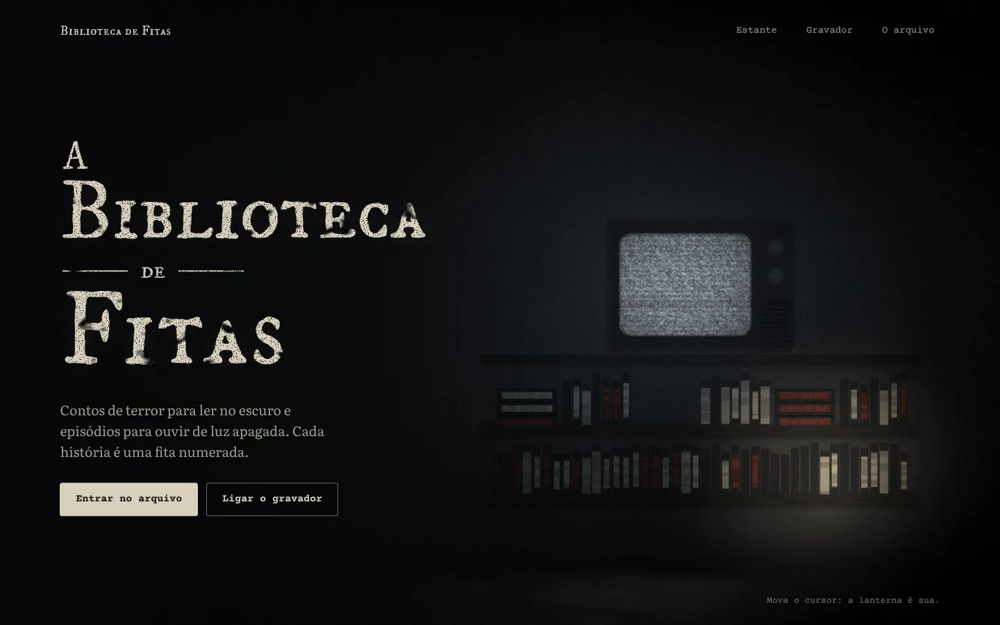
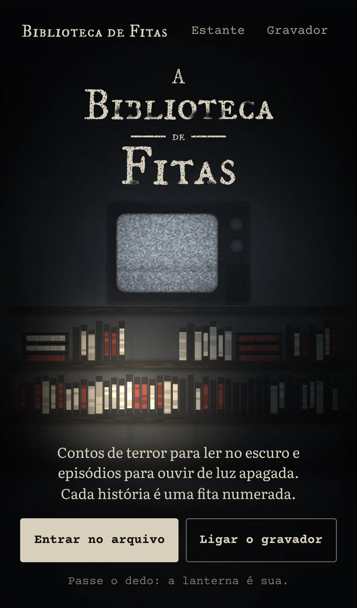
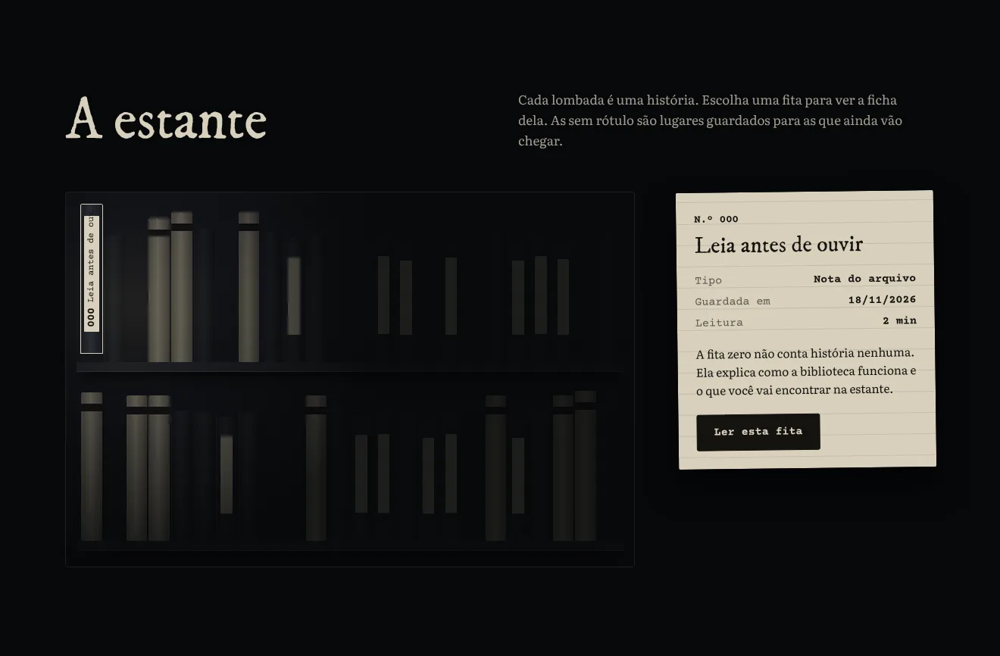
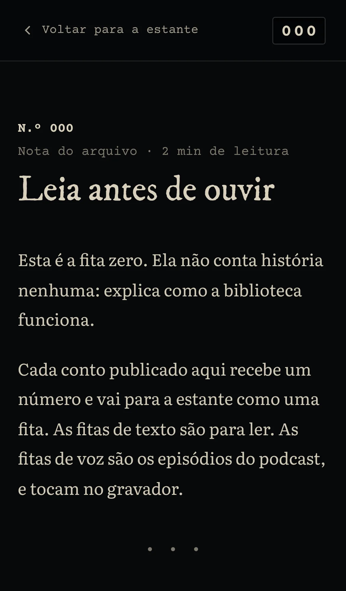
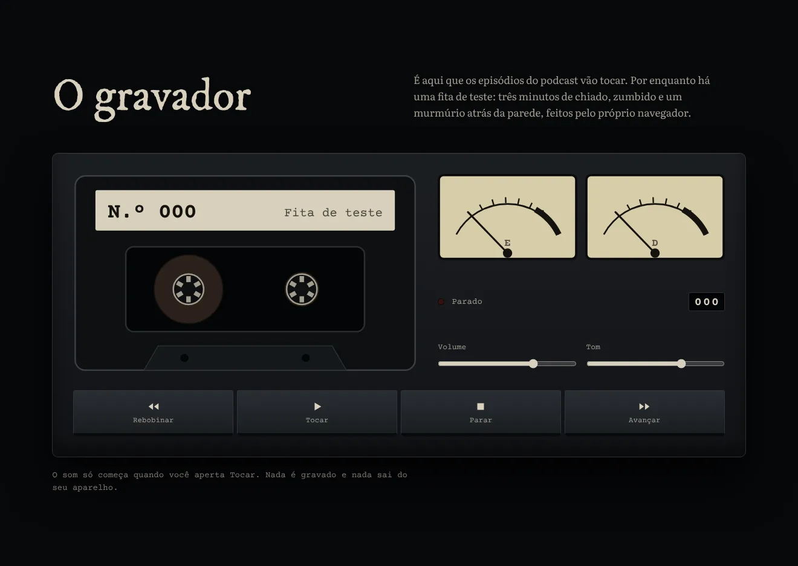
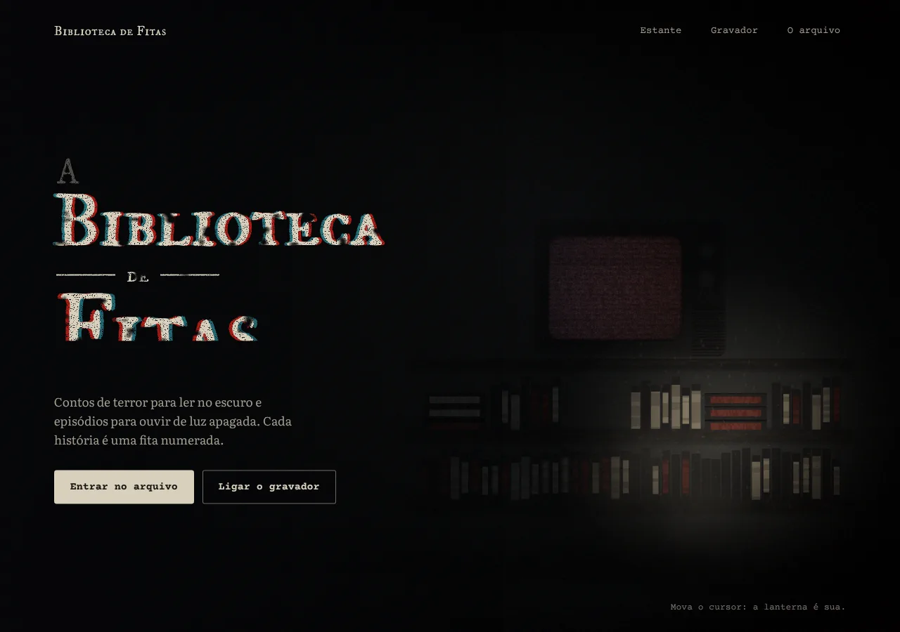
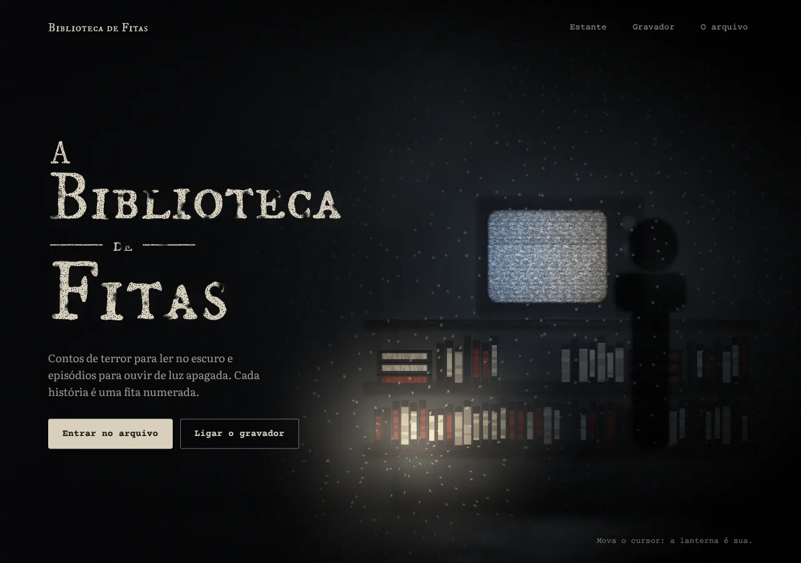
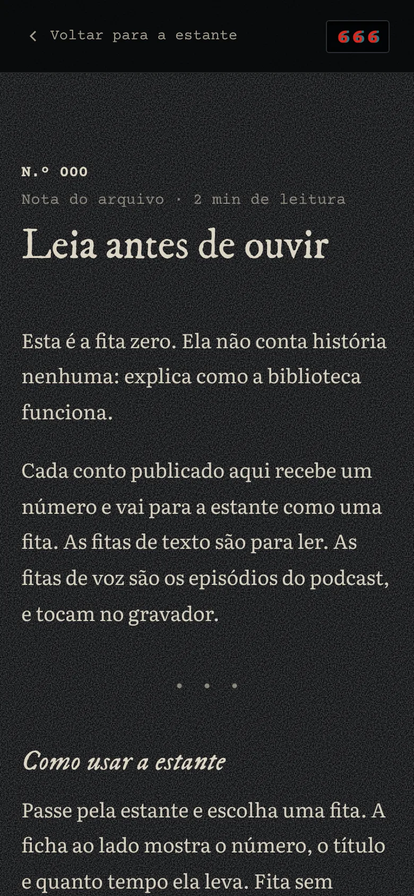

# A Biblioteca de Fitas

Oi, eu sou o Rodrigo Jr, da [Mil e Uma Linhas!](https://mileumalinhas.com.br). Este é o site dos meus contos de terror e do meu podcast. Diferente das vitrines de demonstração que eu faço para mostrar a clientes, este é um **projeto meu de verdade**. As histórias são ficção.

Endereço: https://toshiro01001.github.io/biblioteca-de-fitas/

## O que o site é

Uma biblioteca de fitas cassete. Cada conto é uma fita numerada, guardada numa estante de porão. Quem visita escolhe uma fita, lê o conto na tela e pode apertar as teclas de um gravador de verdade (de mentirinha) para ouvir o chiado da fita. Os episódios do podcast vão tocar nesse mesmo gravador quando chegarem.

Hoje a estante tem **uma fita só: a fita 000**, uma nota minha que explica como a biblioteca funciona. Os contos vêm depois.

## Como usar, em passos

1. Abra o site. No topo, mova o mouse (ou passe o dedo no celular): a lanterna segue você pela cena do porão, com a TV em chuvisco e a estante.
2. Toque em **Entrar no arquivo** para descer até a estante.
3. Toque numa lombada: a ficha ao lado mostra número, título, tipo e tempo de leitura. Em **Ler esta fita**, o conto abre numa página só de leitura, com um contador que gira de 000 a 999 conforme você lê.
4. Em **Voltar para a estante**, você volta onde estava.
5. Em **Ligar o gravador**, aperte tocar, avançar, rebobinar e parar. O chiado é feito pelo próprio navegador, sem arquivo de áudio.
6. Endereço de uma fita: `#/fita/000`. Número que não existe mostra o aviso "Esta fita não está na estante".

## Capturas

| Computador | Celular |
|---|---|
|  |  |
|  |  |
|  | |

## O terror (19/11/2026)

Eu acrescentei ao porão da capa uma névoa rasteira e poeira que sobe na luz da lanterna. De tempos em tempos a TV falha, o título "A Biblioteca de Fitas" treme e se separa em vermelho e azul, e uma sombra cruza a estante. Na leitura há uma estática fraca e o contador da fita pula para 666 de vez em quando. O gravador ganhou um tom grave desconfortável, um coração lento ao fundo e, de longe em longe, um sussurro ou uma pancada surda, tudo gerado em código, sem arquivo de áudio. Com "reduzir movimento" ou sem WebGL, tudo fica parado.

## Som da interface (19/11/2026)

Eu acrescentei sons discretos de interface com o pacote `uisfx`, personalidade `mechanical` (cliques secos de fita e relé). Há um interruptor **Som** na barra do topo e, no rodapé, o mesmo interruptor com volume. Ele começa **desligado**, não toca sozinho e a escolha fica salva no seu aparelho. Os sons marcam só ações que importam: escolher e abrir uma fita, voltar, próxima, rebobinar e as teclas do gravador. O som de teste do gravador continua separado: só toca quando se aperta Tocar.

## Como funciona por dentro

- **Uma página só, com duas telas.** A estante e a leitura são a mesma página. O endereço depois do `#` decide qual aparece: `#/` é a estante, `#/fita/000` é a leitura. Por isso o GitHub Pages não precisa de nada especial.
- **Os contos são arquivos de texto.** Cada fita tem um `.md` em `fitas/` e uma linha em `fitas/indice.json` (número, título, tipo, data, minutos e resumo). A página lê o índice, desenha a estante e, quando alguém abre uma fita, busca o `.md` dela.
- **Nada do conto vira HTML.** O leitor transforma o texto em parágrafos, títulos e itálicos pela árvore de elementos do React. Assim, mesmo um texto com símbolos estranhos não executa nada.
- **A cena do topo é WebGL2.** TV, estante, chão molhado e lanterna são desenhados pela placa de vídeo. Ela só liga depois que a página terminou de carregar. Se o aparelho não tem WebGL, se está lento ou se a pessoa pediu "reduzir movimento", entra uma versão parada e a página funciona inteira do mesmo jeito.
- **O som é sintetizado.** O chiado, o zumbido e o murmúrio do gravador são criados na hora pelo navegador (WebAudio). Não há gravação nem arquivo de áudio. Só toca quando a pessoa aperta a tecla.
- **Rolagem suave** com a biblioteca Lenis, desligada com "reduzir movimento".

## Identidade visual, em resumo

Um porão com uma estante de fitas e uma TV ligada num canal sem sinal. Escuro de verdade, com um único ponto de cor: o vermelho do LED de gravação.

- **Cores:** breu `#07080A`, porão `#0C0E11`, aço `#16191D`, creme de papel velho `#D8D0BD` e o vermelho do LED `#E0241B`.
- **Fontes:** IM Fell DW Pica e IM Fell DW Pica SC nos títulos e no letreiro (com desgaste de tinta velha), Literata no texto dos contos e Courier Prime nas etiquetas e no contador. Todas livres (SIL OFL) e dentro do próprio site.
- **Assinatura:** o rodapé leva a assinatura M1L! | RTJ, com o RTJ vivo.

## Segurança

A página só carrega coisas do próprio endereço (Content-Security-Policy restritiva), não tem script nem estilo escrito dentro do HTML, não envia nada para lugar nenhum, não guarda nada no navegador e não tem cookie nem análise de visitas. O relatório está em [`docs/vistoria.md`](docs/vistoria.md).

## Onde ficam os arquivos

- `index.html`, `404.html` e `404.css`: a página e o aviso de fita não encontrada.
- `assets/`: programa, estilo e fontes já compilados. **Não edite à mão.**
- `fitas/`: `indice.json` e um `.md` por conto.
- `fonts/`: as duas fontes da página 404.
- `img/marca/`: a assinatura M1L! | RTJ.
- `licencas/`: licenças das bibliotecas e das fontes.
- `tests/site.cjs`: os testes (`node tests/site.cjs`).
- `docs/`: capturas e a vistoria de segurança.

A fonte do site (React) fica num repositório privado. Esta pasta recebe só a página já compilada.

## Para adicionar uma fita

1. Escrever o conto em `fitas/NNN.md` (texto simples, parágrafos separados por linha em branco; `##` para título, `---` para divisória, `> citação`, `*itálico*` e `**negrito**`).
2. Acrescentar uma linha em `fitas/indice.json` com `numero`, `titulo`, `tipo` (`conto`, `episodio` ou `nota`), `data`, `minutos`, `resumo` e `arquivo`.
3. Rodar `node tests/site.cjs` com o site servido e conferir a estante no computador e no celular.

## Testes

`node tests/site.cjs` sobe um servidor local e abre o site em 1280x900, iPhone 13 e 320 px. Confere o console, a rolagem horizontal, textos cortados, a estante e a ficha, a leitura da fita 000, a fita inexistente, as teclas do gravador, a versão sem WebGL, o "reduzir movimento" e a página 404.
